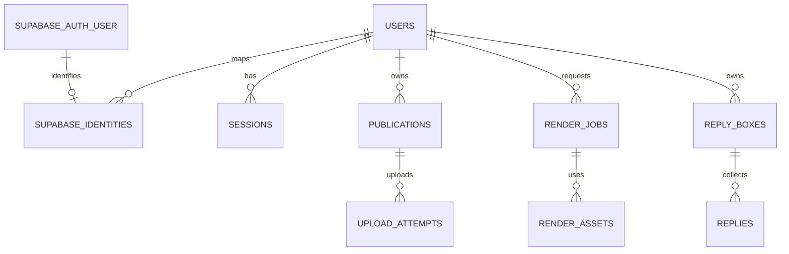

# Accounts and storage

Restyle uses the existing Stickr Supabase project for email/password and Google identity. Application data remains in Cloudflare. Supabase Auth is not the application's content database, and sign-in does not upload editable projects.

## Where data lives

| Store | Location | Data |
| --- | --- | --- |
| Supabase Auth | Stickr project, Authentication → Users | Supabase user UUID, email, provider identities, managed password credentials, verification, provider metadata and Auth session records. Google may supply a name and avatar URL in that metadata. |
| Cloudflare D1 | `DB` binding, currently named `pvo-publications-google` | Minimal Restyle user records, Supabase identity mapping, hashed application sessions, publication ownership, upload/render metadata and collected replies. The database name is historical; it does not determine the authentication provider. |
| Cloudflare R2 | Private `MEDIA` binding, `pvo-publications-media` bucket | Published video/PVO bytes and related media. D1 stores object references and ownership. |
| Browser IndexedDB | The browser and origin used to edit | Editable drafts, source media, checkpoints and undo history. No account-based cloud project sync is implemented. |
| Local beta account store | `PVO_LOCAL_DATA_DIR/auth-accounts.json` | HMAC-derived local user IDs and display names; hashed local session tokens, owner IDs and expiry. This is private Mac storage, not the D1 production database. |

The running beta uses `/Users/christinasmacbook/Desktop/pvo-prototype/.wrangler/local-beta/auth-accounts.json`; its configuration and signing secret stay in that ignored private directory. The frontend is served from the task worktree's generated `dist/`. Other local feature adapters keep their own private reply/render data. Supabase user UUIDs are shared with Stickr authentication, while Restyle and Stickr application/profile records remain separate.

## Restyle D1 model

The canonical schema is in [`migrations/`](../../migrations/). All timestamps are epoch milliseconds.

| Table | Stored fields and purpose |
| --- | --- |
| `users` | `id`, `display_name`, `created_at`. The application profile contains only these three fields. |
| `supabase_identities` | `issuer`, `subject` (Supabase user UUID), `user_id`. Unique issuer/subject maps to one Restyle user; each Restyle user has at most one Supabase identity per project. Email and Google use the same mapping when Supabase returns the same user UUID. |
| `sessions` | `token_hash`, `user_id`, `expires_at`. The cookie contains a signed random token; D1 stores its hash. All newly created Restyle sessions last 15 minutes and logout revokes the record. |
| `publications` | `id`, `owner_id`, idempotency key, title, filename, format/MIME type, byte count, lifecycle status, media object reference, active upload attempt and creation/expiry times. |
| `upload_attempts` | Attempt/publication IDs, object key, multipart upload ID and creation/expiry times. |
| `render_jobs` | Job/owner IDs, source description, lifecycle status, progress, result object key, error and creation/update/expiry times. |
| `render_assets` | Job/asset IDs, object key, byte count, MIME type and upload state/times. |
| `reply_boxes` | Box/owner IDs, title and creation/expiry times. |
| `replies` | Reply/box IDs, submitted answers JSON, keyed source hash and creation time. |
| `maintenance_state` | Internal name/value checkpoints. |

The Supabase-to-D1 relationship is enforced by verified API requests and a unique mapping, not a cross-database foreign key. The remaining relationships use D1 foreign keys. Application APIs authorize the Restyle owner; knowing an ID does not grant access.

## Authentication flow

1. The browser uses the Supabase SDK for password sign-in or Google OAuth with PKCE.
2. Google returns through the exact allowlisted `/editor/?auth=google` callback. Email confirmation and password recovery use `auth=confirm` and `auth=recovery` respectively. The Google callback does not initialize autosave, media or the editor.
3. The browser sends its Supabase access token to the same-origin `/api/auth/supabase/exchange` endpoint. No password is sent to Restyle's server.
4. The Worker verifies project issuer, ES256/RS256 signature, authenticated audience/role, expiration, non-anonymous user and session IDs, then retrieves the confirmed current user from Supabase.
5. The Worker maps that Supabase UUID to a Restyle user and issues a short-lived HttpOnly session cookie. The loopback beta uses the same verification adapter and its private local account store.

Supabase owns provider identity linking. Restyle never merges application users by comparing email addresses. See [Supabase identity linking](https://supabase.com/docs/guides/auth/auth-identity-linking). This change removes the previous direct-Google authentication and manual cross-provider linking APIs; it does not read, migrate or delete their old database records.

## Deployment status

Source and beta changes do not update production automatically. Production requires the Supabase project configuration, the current identity schema, exact production callback allowlist and the repository's normal dev → preprod → prod deployment. No production database reset, user migration or deployment is part of this local change. Google consent and email delivery need an authorized live user journey to verify fully.
